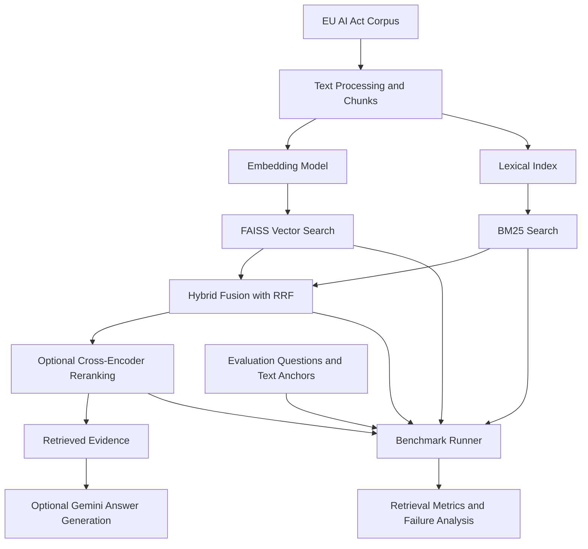

# RagLAB — Retrieval-Augmented Generation for the EU AI Act

**An experimental RAG engineering project for evaluating retrieval strategies on a legal document corpus.**

RagLAB explores how different retrieval strategies affect the quality, relevance, and ranking of evidence retrieved from the European Union Artificial Intelligence Act (Regulation (EU) 2024/1689).

The project combines semantic search, lexical retrieval, hybrid ranking, and an evaluation pipeline to investigate a key question:

> How can we retrieve the right legal evidence before generating an answer?

## Overview

Legal question answering presents a retrieval challenge: a passage can be semantically similar to a question without containing the specific legal obligation needed to answer it.

RagLAB investigates this challenge by comparing retrieval strategies, examining failure cases, and evaluating retrieved passages against human-reviewed textual evidence.

### Key features

- **Semantic retrieval** using Sentence Transformers embeddings and FAISS.
- **Lexical retrieval** using BM25 for exact terms and legal terminology.
- **Hybrid retrieval** combining semantic and lexical rankings with Reciprocal Rank Fusion (RRF).
- **Optional reranking** using a cross-encoder after hybrid retrieval.
- **Retrieval evaluation** using ranking metrics and text-based relevance anchors.
- **Failure analysis** to investigate irrelevant passages, incomplete evidence coverage, and ranking limitations.
- **Streamlit interface** for interactive exploration and system comparison.
- **Optional Gemini generation** for testing answer generation grounded in retrieved passages.

## Architecture



## Retrieval strategies

| Strategy | Purpose |
|---|---|
| `no_retrieval` | Establish a baseline without retrieved context. |
| `naive_rag` | Use a straightforward vector-retrieval pipeline before generation. |
| `vector` | Evaluate semantic retrieval independently. |
| `bm25` | Evaluate lexical retrieval independently. |
| `hybrid` | Combine vector and BM25 rankings through RRF. |
| `agentic` | Explore routing, complementary retrieval, and verification. |

The benchmark protocol is designed to compare these approaches under a consistent evaluation format. Actual availability and execution depend on the current implementation and configuration.

### Why hybrid retrieval?

Semantic search helps identify passages with similar meaning, while BM25 helps match exact legal terms and expressions.

RagLAB combines both rankings using Reciprocal Rank Fusion:

\[
\operatorname{RRF}(d)=
\sum_{r \in R}\frac{1}{k+\operatorname{rank}_r(d)}
\]

where \(d\) is a document, \(R\) is the set of retrieval rankings, and \(k\) is a smoothing constant.

This approach combines complementary ranking signals without requiring raw similarity scores from different retrieval systems to be directly comparable.

## Evaluation methodology

RagLAB focuses on retrieval quality rather than assuming that a fluent answer is necessarily a correct one.

The evaluation pipeline includes:

- **Recall@k** — whether relevant evidence appears in the retrieved results.
- **Precision@k** — the proportion of retrieved results judged relevant.
- **MRR@k** — how highly the first relevant result is ranked.
- **nDCG@k** — ranking quality when relevance varies across results.
- **Article coverage** — coverage of relevant AI Act articles.
- **Generation evaluation** — grounding and hallucination-related measures when answer generation is enabled and the necessary evaluation data is available.

Textual anchors are used to assess evidence relevance independently of chunk IDs, helping separate evaluation from a particular chunking strategy.

### What failure analysis investigates

The project examines issues such as:

- Semantically similar passages that describe obligations for the wrong legal actor.
- Incomplete retrieval when a question requires evidence from multiple passages.
- The effect of a fixed top-k cutoff on legal evidence coverage.
- Ranking ties and reproducibility.
- The difference between retrieval quality and answer-generation quality.

These analyses help identify where larger retrieval windows, article-aware filtering, reranking, or improved query strategies may be useful.

## Getting started

### 1. Clone the repository

```powershell
git clone https://github.com/Herchan321/RagLAB.git
cd RagLAB
```

### 2. Create a virtual environment

```powershell
py -m venv .venv
.\.venv\Scripts\Activate.ps1
```

If PowerShell blocks script activation, use the environment's Python executable directly instead.

### 3. Install dependencies

```powershell
python -m pip install --upgrade pip
python -m pip install -r requirements.txt
```

### 4. Configure Gemini (optional)

Create a `.env` file in the project root if your local implementation loads environment variables from it:

```text
GEMINI_API_KEY=your_api_key_here
```

Keep API keys out of Git. The generation feature is optional; retrieval experiments that do not invoke Gemini do not require this key.

### 5. Launch the Streamlit application

```powershell
python -m streamlit run app.py
```

The interface provides tools for comparing retrieval systems, exploring the assistant, inspecting benchmark results, and reviewing methodology and limitations.

## Running the benchmark

Run the development benchmark with:

```powershell
python benchmark_runner.py `
  --split dev `
  --output data/evaluation/results.dev.json
```

To use the version 3 question dataset explicitly:

```powershell
python benchmark_runner.py `
  --questions data/evaluation/questions.v3.json `
  --split dev `
  --output data/evaluation/results.v3.dev.json
```

To enable Gemini generation, after configuring the API key:

```powershell
python benchmark_runner.py `
  --split dev `
  --generate
```

Verify the available arguments and dataset paths against the current repository before running these commands. Development results should not be presented as final test-set results.

## Project structure

```text
RagLAB/
├── app.py
├── benchmark_compare.py
├── benchmark_runner.py
├── check_anchors.py
├── evaluate.py
├── validate_questions.py
├── requirements.txt
├── src/
│   ├── retrieval.py
│   ├── rag.py
│   ├── eval_metrics.py
│   └── retrieval/
│       ├── bm25_search.py
│       └── hybrid_search.py
├── data/
│   └── evaluation/
├── tests/
└── README.md
```

*The structure above highlights the main components; the exact files and data subdirectories may evolve.*

## Current status

RagLAB is an experimental engineering project. Its current focus is retrieval implementation, evaluation methodology, and systematic analysis of failure cases.

Implemented components include vector retrieval, BM25, hybrid RRF fusion, benchmark tooling, and an optional reranking path.

The evaluation datasets are still subject to review, and development results should be distinguished from final held-out test results. No performance improvement is claimed here without verified benchmark results.

## Roadmap

- Finalize and review the held-out test questions and relevance anchors.
- Run reproducible comparisons across retrieval strategies.
-  Investigate article-aware filtering and context expansion.
- Measure the effect of optional cross-encoder reranking.
- Evaluate generated answers against evidence and legal grounding criteria.
-Document benchmark results, limitations, and reproducibility details.

## Limitations

RagLAB is an experimental system, not a legal advice service. Retrieved passages and generated answers require verification against the authoritative legal text.

Retrieval metrics depend on the quality and completeness of relevance annotations. A system can retrieve relevant evidence without retrieving every passage required to answer a complex question.

## Tech stack

`Python` · `FAISS` · `Sentence Transformers` · `BM25` · `RRF` · `Cross-Encoder Reranking` · `Streamlit` · `Gemini API` · `pytest`

## Author

**Asma Herchan**

- GitHub: [@Herchan321](https://github.com/Herchan321)

